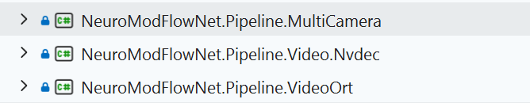
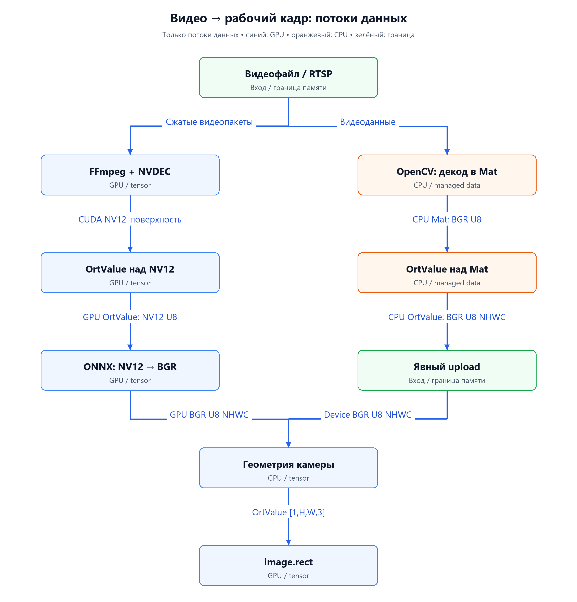
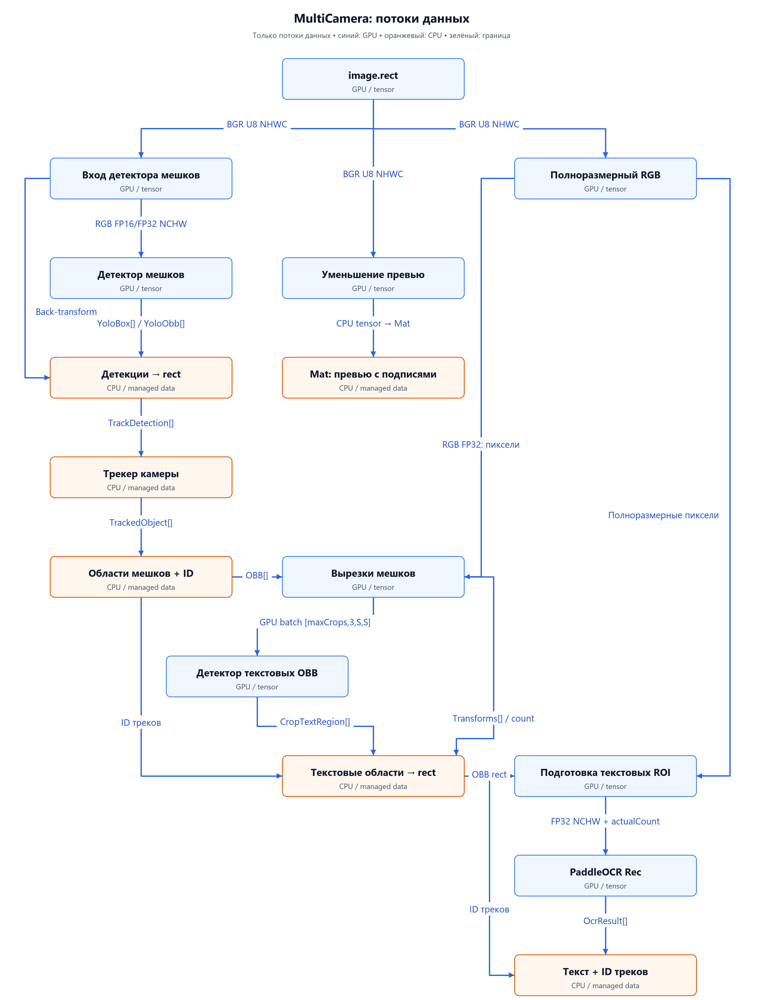
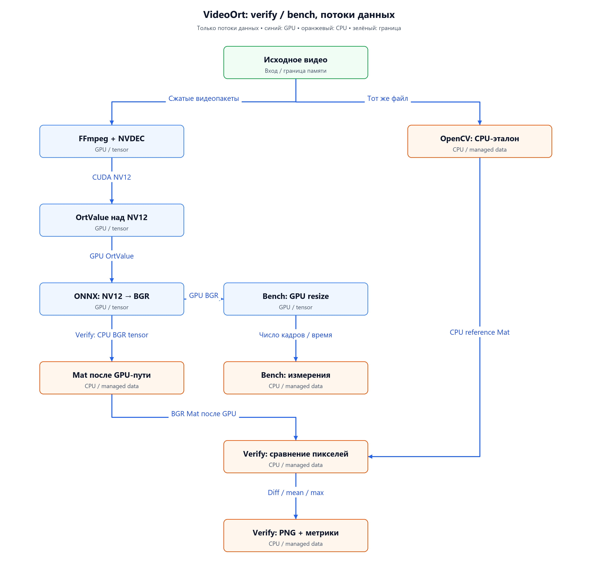

# Видео → ONNX Runtime → MultiCamera: роли проектов и потоки данных

Снимок реализации: **2026-10-08**. Сохранено полное объяснение проектов со схемами.
Источник — текущий код и Roslyn MCP; новый runtime/GPU-прогон при подготовке документа не выполнялся.



На скриншоте — **две запускаемые лаборатории и одна библиотека, которую они обе используют**. Их разделение соответствует трём задачам: получить видеокадр в GPU-памяти, проверить этот путь отдельно и затем использовать его в полном многокамерном распознавании.

Я проверил текущий код, связи проектов и C#-символы через Roslyn. Ниже описана существующая реализация; видеопотоки и GPU-тесты в этом разборе не запускались.

| Проект | Что это | Для чего нужен |
|---|---|---|
| `NeuroModFlowNet.Pipeline.Video.Nvdec` | Библиотека | Декодирует видео через NVDEC и предоставляет кадр для ONNX Runtime |
| `NeuroModFlowNet.Pipeline.VideoOrt` | Консольная лаборатория | Проверяет корректность и измеряет скорость цепочки «видео → GPU → ONNX Runtime» |
| `NeuroModFlowNet.Pipeline.MultiCamera` | Консольная лаборатория | Выполняет полный путь нескольких камер: подготовка → детекция → трекинг → OCR |

`MultiCamera` и `VideoOrt` напрямую ссылаются на `Video.Nvdec`. Между собой эти два приложения не связаны: запуск `MultiCamera` не требует запуска `VideoOrt`.

**Что именно делает `Video.Nvdec`.**

На вход приходит сжатое видео: например, файл с H.264/HEVC или RTSP-поток. Оно ещё не является массивом пикселей, который можно передать нейросети.

`NvdecVideoDecoder` сначала использует FFmpeg для чтения контейнера или сетевого потока и выделения видеопакетов. Затем FFmpeg задействует аппаратный декодер NVIDIA — NVDEC. На выходе получается декодированный кадр в CUDA-памяти.

Здесь важно различать роли:

- **FFmpeg** читает поток, разбирает контейнер и организует декодирование.
- **NVDEC** выполняет аппаратное декодирование сжатого видео.
- **ONNX Runtime** затем выполняет преобразования изображения и нейросетевой инференс.

Выбор CUDA или TensorRT для ONNX-операций относится к следующей части обработки. Сам NVDEC — отдельный аппаратный декодер.

Текущий путь принимает **8-битные NV12-поверхности**. Если FFmpeg не предоставляет CUDA-кадр, формат поверхности другой или её расположение в памяти не соответствует ожиданиям, код завершает работу ошибкой. Автоматического перехода на программный декод нет. Это видно в [NvdecVideoDecoder.cs](../../labs/NeuroModFlowNet.Pipeline.Video.Nvdec/NvdecVideoDecoder.cs) и [NvdecFrame.cs](../../labs/NeuroModFlowNet.Pipeline.Video.Nvdec/NvdecFrame.cs).

**Почему сначала получается NV12, а дальше требуется BGR.**

NV12 хранит изображение двумя плоскостями:

- Y — яркость каждого пикселя;
- UV — чередующиеся компоненты цветности с меньшим разрешением.

Это формат выхода видеодекодера. Дальнейшая программа здесь принимает другой контракт: **BGR U8 NHWC**, то есть байтовые пиксели с тремя цветовыми каналами и формой `[1, H, W, 3]`.

Поэтому после декодирования выполняется `Op_Onnx_Nv12_To_BgrU8Nhwc`. Она строит небольшой ONNX-граф, который выделяет полезные области Y и UV, увеличивает цветность, применяет цветовую матрицу и формирует BGR-тензор. Всё это выполняется через выбранный ONNX backend.

Цветовая матрица задаётся явно: BT.601 или BT.709, полный или ограниченный диапазон. От неё зависит правильность цветов и яркости. Размер поверхности и цветовые параметры учитываются при подготовке kernel-а. Реализация находится в [Nv12ToBgrGraphBuilder.cs](../../labs/NeuroModFlowNet.Pipeline.Video.Nvdec/Nv12ToBgrGraphBuilder.cs).

**Что здесь означает zero-copy.**

`NvdecFrame.CreateNv12Tensor()` создаёт `OrtValue` **поверх уже существующего указателя на GPU-память**. Пиксели для этой обёртки не скачиваются в оперативную память и не загружаются обратно.

Но последующие преобразования создают выходные тензоры. NV12 → BGR, исправление перспективы, resize и нормализация требуют вычислений и памяти для результатов.

Кроме того, FFmpeg внутри декодирования может копировать данные между GPU-поверхностями. Поэтому точный смысл zero-copy здесь такой: **на границе «выход декодера → вход ONNX Runtime» нет дополнительного копирования пикселей для создания `OrtValue`.**

Есть два обязательных условия.

Первое — **кадр должен оставаться живым**. `OrtValue` не владеет памятью декодера. Если вернуть поверхность в пул раньше окончания обработки, следующий кадр может перезаписать её. В `MultiCamera` объект `NvdecSourceFrame` удерживает и поверхность, и тензорную обёртку до освобождения контекста запуска.

Второе — **запись кадра должна завершиться до чтения его ONNX Runtime**. Для этого используется `CudaDecodeFence`: декодер ожидает завершения работы в CUDA-stream, которым пользуется FFmpeg. Общий CUDA-контекст делает указатель доступным, но сам по себе не гарантирует готовность данных. Подробнее это описано непосредственно в [CudaDecodeFence.cs](../../labs/NeuroModFlowNet.Pipeline.Video.Nvdec/CudaDecodeFence.cs).

Ниже первая схема. Все стрелки показывают передачу данных; NVDEC и CPU — явно выбираемые варианты входа.



[SVG](images/video-dataflow/video-ingest.svg) · [Исходная Mermaid-схема](images/video-dataflow/video-ingest.mmd)

**Зачем отдельный `VideoOrt`.**

Он позволяет исследовать входной видеотракт без детектора мешков, трекера и OCR. В нём два режима.

`verify` проверяет корректность изображения. Один файл проходит по двум путям:

1. NVDEC → GPU NV12 → ONNX-конвертация в BGR → выгрузка в CPU `Mat`.
2. Декодирование того же файла через OpenCV в CPU `Mat`.

Затем изображения покадрово сравниваются. Программа считает среднюю и максимальную абсолютную разницу и сохраняет изображения для первого и худшего по средней разнице кадра.

Идеальной побитовой идентичности проверка не требует: способы увеличения цветности могут отличаться. Успех определяется порогом средней разницы. Такой тест помогает обнаружить неверную цветовую матрицу, ошибки учёта расположения плоскостей и чтение ещё не готового кадра. Код: [VerifyCommand.cs](../../labs/NeuroModFlowNet.Pipeline.VideoOrt/Hosting/VerifyCommand.cs).

`bench` измеряет производительность нескольких независимых потоков. Для каждого создаются собственный декодер и собственный VM-контроллер. Обычная цепочка:

**NVDEC → NV12/BGR-конвертация → resize на GPU.**

Обработанное изображение в этом режиме не скачивается для просмотра. Параметр `--decode-only` оставляет только декодирование, позволяя отдельно оценить его пропускную способность. Другие параметры задают число потоков, число одновременных запусков, размер resize и режим разделения ONNX-сессий.

Поэтому FPS из `VideoOrt bench` характеризует именно эту короткую цепочку. Полная обработка в `MultiCamera` добавляет нейросети, трекинг и OCR. Код: [BenchCommand.cs](../../labs/NeuroModFlowNet.Pipeline.VideoOrt/Hosting/BenchCommand.cs).

**Как устроен `MultiCamera`.**

Для каждой камеры создаётся собственный `CameraWorker`. Он содержит источник кадров, очередь, `VmController` и состояние этой камеры.

Контроллер исполняет две программы подряд:

`prepare:<camera> → common`

Для одного кадра обе программы используют один `VmRunContext`: тот же набор регистров, идентификатор запуска и правила освобождения ресурсов. Поэтому результат подготовки просто остаётся в регистре `image.rect`, из которого его читает общая программа.

`prepare` учитывает особенности конкретной камеры: исправление дисторсии, перспективу, поворот, crop, resize. Порядок берётся из конфигурации.

**`image.rect` — центральный контракт всей последующей обработки.** Это изображение после заданных геометрических преобразований. Детекции, треки, зоны и найденный текст далее приводятся к координатам этого изображения. Если последним преобразованием был resize, рабочее разрешение уже включает этот resize.

Почему по контроллеру на камеру? У камер разные геометрия, зоны, история трекера и порядок кадров. Собственное состояние позволяет вести всё это независимо.

При этом `common` одинаков по коду, но создаётся отдельным экземпляром для каждого контроллера. Инструкции содержат изменяемые native-объекты, например `IoBinding` и `RunOptions`. Дорогие ресурсы переиспользуются через общие inference endpoint-ы и kernel cache. Решение объяснено в [ADR-001](../../docs/architecture/ADR-001_program_chain_per_controller.ru.md).

**Что происходит с кадром после подготовки.**

Общая программа сначала готовит уменьшенное изображение для детектора мешков. Размер входа задаётся для камеры. Используется stretch или letterbox, затем преобразование BGR U8 в RGB FP16/FP32 NCHW с делением на 255.

Детектор возвращает массив боксов или OBB. Их координаты относятся к его входному изображению, поэтому следующим шагом они переводятся обратно в `image.rect`.

Из детекций выбранного класса формируется вход трекера. Трекер связывает наблюдения между кадрами и выдаёт `TrackedObject[]`. Его состояние сохраняется между запусками данной камеры; обновление состояния упорядочено, даже когда одновременно обрабатывается несколько кадров.

Для OCR выбираются **подтверждённые треки, которые видны в текущем кадре**. Их области вырезаются из полноразмерного рабочего изображения и собираются в GPU-batch с letterbox.

На этих вырезках работает детектор текста. Он определяет, где находятся надписи, после чего координаты текстовых областей возвращаются в пространство `image.rect` и связываются с ID соответствующих треков.

Затем происходит важный шаг: **регионы для распознавания текста заново вырезаются из полноразмерного рабочего изображения**. Они подготавливаются под PaddleOCR Rec, который возвращает массив распознанных результатов.

Так уменьшается объём работы детекторов, а для распознавания используются более подробные исходные пиксели. Точность найденных областей всё равно влияет на результат, но дополнительное уменьшение изображения для детектора мешков напрямую не становится разрешением входа OCR. Вся последовательность видна в [CommonProgramFactory.cs](../../labs/NeuroModFlowNet.Pipeline.MultiCamera/Programs/CommonProgramFactory.cs).

Вторая схема показывает этот поток. Стрелки с областями и координатами — такие же потоки данных, как стрелки с изображениями.



[SVG](images/video-dataflow/multicamera.svg) · [Исходная Mermaid-схема](images/video-dataflow/multicamera.mmd)

**Где здесь CPU и где GPU.**

Большие изображения в выбранном GPU-пути остаются на GPU: декодированный NV12, BGR, результаты геометрии, входы моделей и OCR-вырезки.

Организация работы, конфигурация, трекер, массивы объектов, ID и строки живут в managed-памяти. Это ожидаемо: трекеру нужны координаты и признаки объектов.

Превью — отдельная ветка. Рабочее изображение сначала уменьшается на GPU, затем переносится в CPU `Mat` для рисования и показа. Поэтому включённое превью добавляет явный перенос изображения и работу CPU.

**Два нюанса текущей реализации.**

Первый — **общий endpoint ещё не означает общий batch камер**. В текущем `SharedInferenceEndpoints` для детектора, text OBB и recognition установлено `MaxBatchSize: 1` и нулевое ожидание сборки batch. Детектор имеет endpoint на каждый файл модели; камеры с одинаковой моделью используют его совместно. Text detection и recognition также общие.

При этом одна OCR-заявка уже может содержать массив вырезок. Следовательно, сейчас есть batch областей внутри кадра, а объединение заявок нескольких камер здесь отключено. Это видно в [SharedInferenceEndpoints.cs](../../labs/NeuroModFlowNet.Pipeline.MultiCamera/Programs/SharedInferenceEndpoints.cs).

Второй — **`MultiCamera` отдаёт приоритет свежести кадров**. Очередь каждой камеры вмещает два кадра; при переполнении старый кадр удаляется и освобождается. Это ограничивает накопление задержки, но означает, что при перегрузке обработку проходят не все кадры. Дополнительно `MaxInFlight` ограничивает число одновременно выполняемых запусков. Механизм находится в [CameraWorker.cs](../../labs/NeuroModFlowNet.Pipeline.MultiCamera/Hosting/CameraWorker.cs).

Именно поэтому проекты разделены: видеотракт можно проверять и измерять самостоятельно через `VideoOrt`, а его реализацию использовать в более сложном `MultiCamera`. Сейчас все три находятся в `labs`: это библиотека экспериментального видеопути и два приложения для его исследования и применения.

## VideoOrt: отдельная схема проверки и измерений

Ветка verify передаёт CPU-картинки в покадровое сравнение. Ветка bench оставляет
изображение на GPU после resize и передаёт в статистику только численные измерения.
При `--decode-only` VM-операции пропускаются и измеряется NVDEC.



[Редактируемый SVG](images/video-dataflow/videoort.svg).

## Схемы SeMaps

Откройте [neuromodflownet.semaps](../../neuromodflownet.semaps). Добавлены отдельные виды:

| Вид | Что показывает | Открыть в локальном редакторе |
| --- | --- | --- |
| `v_video_ingest_dataflow` | Вход NVDEC / OpenCV → GPU-кадр → image.rect | [Вход видео](http://localhost:32905/app/#v_video_ingest_dataflow) |
| `v_multicamera_dataflow` | Детекция мешков → трекер → вырезки → text OBB → PaddleOCR Rec; ветка превью | [MultiCamera](http://localhost:32905/app/#v_multicamera_dataflow) |
| `v_videoort_dataflow` | verify и bench | [VideoOrt](http://localhost:32905/app/#v_videoort_dataflow) |

Все связи новых видов — `data-flow`. Блоки обозначают стадии обработки и границы
данных, а не связи наследования, владения, зависимости сборок или управления.
Структурные виды `Lab NVDec` и `Lab NVDec Top` сохраняют прежнюю раскладку.

PNG из самого редактора SeMaps:

- [Вход видео](images/video-dataflow/semaps-video-ingest.png).
- [MultiCamera](images/video-dataflow/semaps-multicamera.png).
- [VideoOrt](images/video-dataflow/semaps-videoort.png).

Новые виды содержат 34 блока и 39 связей `data-flow`. Для блоков созданы общие
именованные стили `dataflow.stage.gpu`, `dataflow.stage.cpu`, `dataflow.stage.boundary`;
форматы данных подписаны на стрелках. Названия и описания блоков доступны в RU/EN.

Проверка при сохранении: `render_view` всех трёх видов — `no problems found`.
`semaps check neuromodflownet.semaps` завершается с кодом 1 из-за семи прежних
замечаний; новые виды замечаний не добавили. Исходные замечания: независимые EN/RU
названия `v_execution_providers` и `v_pipeline`, отсутствующие EN-названия
`v_lab_nvdec`, `v_lab_nvdec_top`, `v_manual`, а также разные контейнеры `e_onnxmodel`
и `e_iop` в видах на одной оси `axis_classes`.

PNG — готовые изображения; SVG — редактируемые векторные изображения.
Исходные Mermaid-файлы сохраняют две схемы из исходного объяснения.
Спецификация расширенных рисунков — [dataflow-spec.json](images/video-dataflow/dataflow-spec.json),
генератор — [render_dataflow.py](images/video-dataflow/render_dataflow.py) (Python + Pillow).
Он генерирует только иллюстрации документации, не читает и не редактирует workspace SeMaps.

Повторная генерация картинок из корня репозитория:

```powershell
python docs/architecture/images/video-dataflow/render_dataflow.py
```

Ограничения проверки: фактическая скорость и корректность на текущем GPU/видеопотоке
этим документом не подтверждаются. Для этого служат отдельные запуски `VideoOrt verify`
и `VideoOrt bench`, затем полный сценарий `MultiCamera`.

